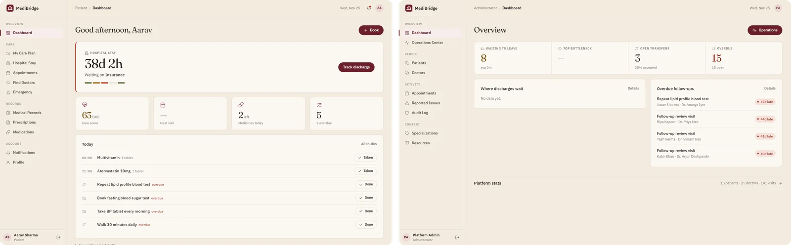
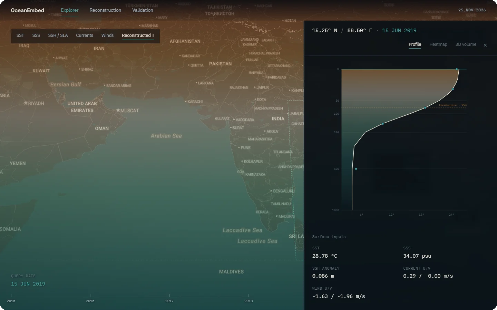
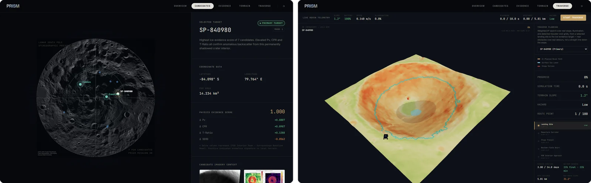
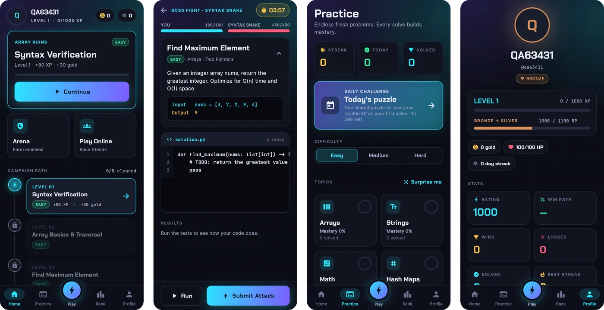
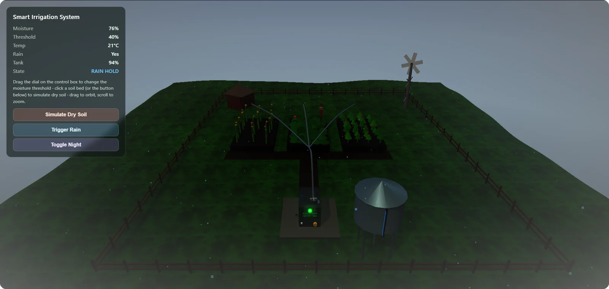

# Sohan Narewadi

Software developer. I like building things end to end: the data and models, the backend, and the interface people actually use.

Currently working with full-stack web and machine learning.

## Selected work

- **[OceanEmbed](https://github.com/arsiwalamoiz24/OceanEmbed-SIH-2026)**: subsurface ocean temperature reconstruction over the Bay of Bengal from satellite data. Python, PyTorch, FastAPI, React.
- **[PRISM](https://github.com/arsiwalamoiz24/SIH-26-internal-round)**: lunar south-pole water-ice screening and rover traverse planning, with a 3D dashboard. Python, YOLOv8, Next.js, Three.js.
- **[MediBridge](https://github.com/Sohan-Narewadi/MediBridge)**: healthcare platform for appointments, records and prescriptions. Node.js, Express, MySQL.
- **[CodeWar](https://github.com/Sohan-Narewadi/Flutter---Mini-Project---CodeWar)**: game-style coding practice app. Flutter, Dart.
- **[Smart Irrigation 3D](https://github.com/Sohan-Narewadi/smart_irrigation_3d)**: interactive visualisation of an Arduino irrigation circuit. Three.js.
- **[Supermarket Analysis](https://github.com/Sohan-Narewadi/Supermarket-Customer-Purchase-Analysis)**: market-basket rules and customer segmentation in a Streamlit dashboard. Python.

## Dashboards

**MediBridge**: patient and admin dashboards

**OceanEmbed**: Bay of Bengal explorer with a reconstructed temperature-depth profile (shown with demo data)

**PRISM**: lunar south-pole candidate screening and 3D rover traverse planner

**CodeWar**: campaign, battle, practice and profile screens

**Smart Irrigation 3D**: farm simulation with a live sensor panel

## Tools

Java, C, JavaScript, Python, Dart · Node.js, React, Next.js, FastAPI, Flutter · PyTorch, Streamlit · Three.js, Arduino

## Activity

<picture>
  <source media="(prefers-color-scheme: dark)" srcset="https://raw.githubusercontent.com/Sohan-Narewadi/Sohan-Narewadi/output/snake-dark.svg" />
  
</picture>

## Contact

[LinkedIn](https://www.linkedin.com/in/sohan-narewadi-2b6b51367/) · [Email](mailto:sohan.n@somaiya.edu) · [Portfolio](https://sohan-narewadi.dev)
